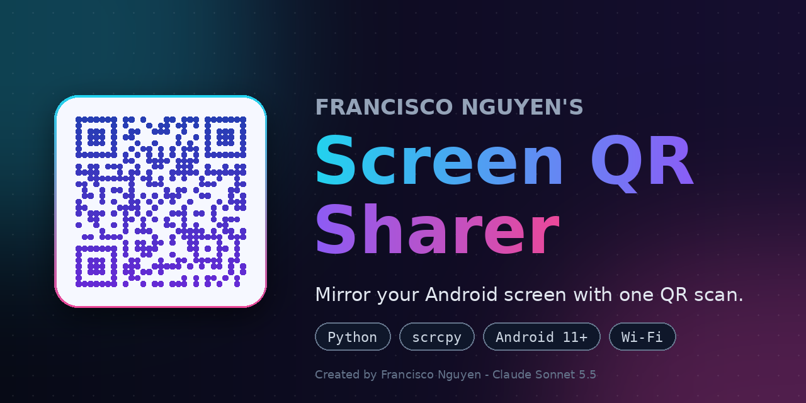

<p align="center">
  
</p>

# Francisco Nguyen's Screen QR Sharer

Mirror your **Android phone or tablet** screen on your laptop by scanning one QR code. No cables, no typing IP addresses or ports.

The script shows a pairing QR code in your terminal. You scan it from Android's **Wireless debugging** screen, and it pairs with the device, connects over Wi-Fi, and opens a window on your laptop showing (and letting you control) the device's screen. Mirroring itself is done by [scrcpy](https://github.com/Genymobile/scrcpy).

> Created by Francisco Nguyen - Claude Sonnet 5.5

## Features

- **One-scan pairing** using Android's built-in wireless debugging QR format
- **Settings menu** for resolution, frame rate, bitrate, presets, and a few toggles
- **Saved settings**: your choices are remembered between runs
- **Colored console** with a logo, and a timestamped log of every action
- **Plain-text log file** (`phone_mirror.log`) with a session summary at the end
- Works on **Windows, macOS and Linux**

## Requirements

| What | Notes |
| --- | --- |
| Python 3.8+ | |
| `zeroconf`, `qrcode[pil]` | Python packages |
| [scrcpy](https://github.com/Genymobile/scrcpy) and `adb` | Must be on your `PATH` |
| Android 11 or newer | Needed for Wireless debugging with QR pairing |
| Same Wi-Fi network | Laptop and Android device must be on the same network |

## Installation

```bash
git clone https://github.com/<your-username>/<your-repo>.git
cd <your-repo>
pip install zeroconf "qrcode[pil]"
```

Then install scrcpy (it includes or needs `adb`):

- **Windows:** download the zip from the [scrcpy releases](https://github.com/Genymobile/scrcpy/releases) (it includes `adb.exe`), unzip it somewhere permanent such as `C:\scrcpy`, and add that folder to your `PATH`. Reopen your terminal afterwards.
- **macOS:** `brew install scrcpy android-platform-tools`
- **Linux:** `sudo apt install scrcpy adb`

Check that both are found:

```bash
scrcpy --version
adb version
```

## Usage

1. On your Android device, turn on **Developer options** (Settings → About phone → tap **Build number** 7 times).
2. Run the script on your laptop:
   ```bash
   python phone_mirror_qr.py
   ```
3. Adjust settings in the menu if you like, then press **Enter** to start.
4. On your device open **Settings → Developer options → Wireless debugging → Pair device with QR code**, and scan the code shown in the terminal.
5. The mirror window opens. Close it or press **Ctrl+C** to stop.

> The code must be scanned from the Wireless debugging screen. A normal camera app or Google Lens can't use it, because Android only accepts pairing from its own settings.

After a successful pairing, some devices remember your laptop, so later you may only need to switch Wireless debugging on.

## Settings menu

| Setting | Options |
| --- | --- |
| Resolution (longest side) | 640, 960, 1280, 1600, 1920 px, or Native |
| Frame rate | 30, 60, 90, 120 fps, or Device maximum (no cap) |
| Bitrate | 4, 8, 16, 32, 64 Mbps |
| Presets | Fast & light, Balanced, Smooth, Max quality |
| Keep device awake | On / Off |
| Turn device screen off | On / Off |
| Sound from device | On / Off (needs scrcpy 2.0+ and Android 11+) |

The default is **Smooth** (1280 px, no frame rate cap, 16 Mbps). The frame rate can't go above what your device's screen and your Wi-Fi deliver, so a 60 Hz screen stays at 60 fps even if you pick 120. If the video stutters, try 5 GHz Wi-Fi, or lower the resolution or bitrate.

Settings are saved to `phone_mirror_settings.json` next to the script.

## Troubleshooting

| Problem | Try this |
| --- | --- |
| `Missing from PATH: adb, scrcpy` | Install them and make sure the folder is on your `PATH`, then reopen the terminal |
| "Timed out - the QR code was not scanned" | Scan from **Wireless debugging → Pair device with QR code**, not the camera app. Run the script again for a new code |
| Device is never found | Both devices must be on the same Wi-Fi. Guest networks, VPNs and some routers block device discovery (mDNS) |
| "Pairing failed" | Keep the Wireless debugging screen open while scanning, then retry |
| "Device did not advertise a connect port" | Make sure Wireless debugging is still switched on |
| Laggy or choppy video | Lower resolution or bitrate, or move to 5 GHz Wi-Fi |
| No colors in the console | Use Windows Terminal or a modern terminal, or set `NO_COLOR` to disable colors on purpose |
| Firewall prompt | Allow Python and `adb` on your private network |

## Limitations

- **Android only.** iPhones and iPads can't be mirrored this way, because Apple doesn't allow a QR code to start mirroring. On a Mac you can use QuickTime Player (File → New Movie Recording) or an AirPlay receiver such as [UxPlay](https://github.com/FDH2/UxPlay).
- Requires Android 11 or newer.
- No audio from the laptop to the device. Device sound is forwarded only if your scrcpy and Android versions support it.

## Bonus: show your laptop screen on a phone

`screen_qr.py` goes the other way: it streams your **laptop** screen to a phone or tablet browser. Run it, scan the QR code with any camera app on the same Wi-Fi, and the screen appears in the browser. A random token in the link keeps the stream private to whoever has the QR code.

```bash
pip install mss pillow "qrcode[pil]"
python screen_qr.py
```

On macOS, give your terminal **Screen Recording** permission first. It has no audio, and it may not work on Linux with Wayland.

## Project files

| File | Purpose |
| --- | --- |
| `phone_mirror_qr.py` | Main app: pair an Android device by QR and mirror it to your laptop |
| `screen_qr.py` | Bonus: stream your laptop screen to a phone browser |
| `social_preview.png` | Repository social preview image (1280×640) |

Generated at runtime: `phone_mirror.log`, `phone_mirror_settings.json`, `phone_mirror_qr.png`, `screen_qr.log`, `screen_qr.png`. You may want to add these to `.gitignore`.

## Credits

- Screen mirroring by [scrcpy](https://github.com/Genymobile/scrcpy) from Genymobile
- Created by Francisco Nguyen - Claude Sonnet 5.5